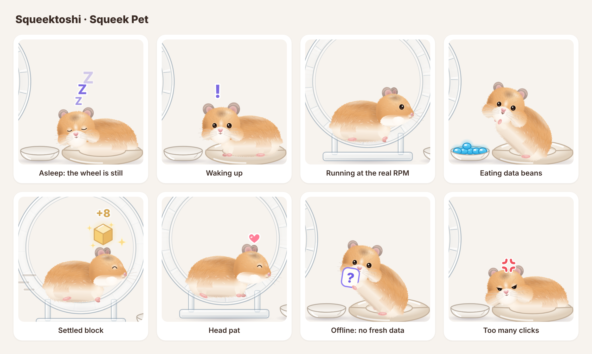
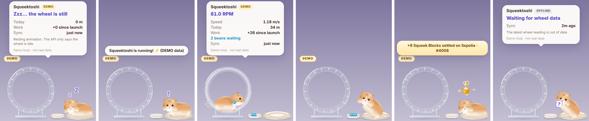
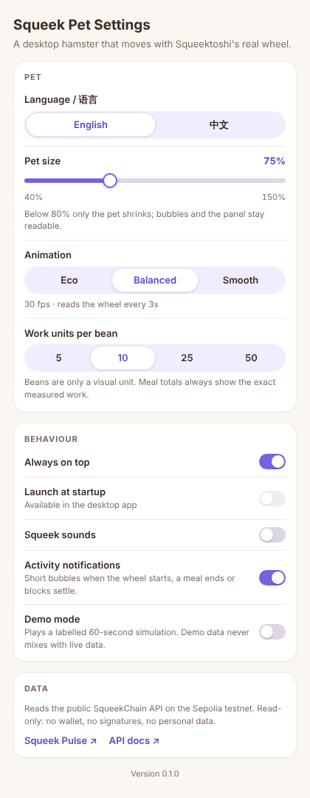
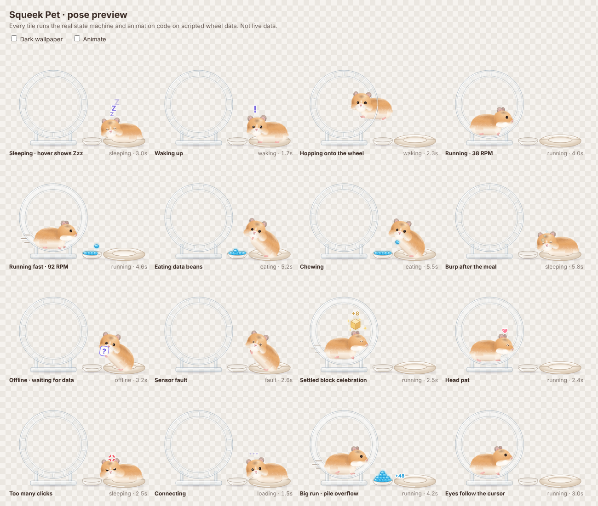

# Squeek Pet

A desktop hamster that moves with **Squeektoshi's real hamster wheel** on SqueekChain (Sepolia testnet).

When the real wheel turns, the pet wakes up and runs at the wheel's measured RPM. New measured work turns into glowing blue data beans that pile up beside the wheel; when the run ends, the pet eats them and burps the exact total. Settled Squeek Blocks pop a gold block. When the data is late or missing, the pet hugs a question mark instead of pretending to sleep.

Normally there is only a small hamster in the corner of the screen. Hover it for a status bubble, double-click for a mini panel.





> Status: **MVP, version 0.1.0.** Built and launched on Linux and on an Apple Silicon Mac. **Not yet built on Windows**, and how it looks on the macOS desktop is still unchecked — see [What has been verified](#what-has-been-verified).

## How the real wheel drives the pet

Everything comes from one read-only request, `GET https://api.squeekchain.com/v1/status` (schema version 1), polled every 2 to 10 seconds depending on the performance setting.

| API field | What the pet does |
| --- | --- |
| `measurement.coreStatus` = `ACTIVE` | Wakes up (eyes, ears, shake), hops onto the wheel and runs side-on, looking ahead along the wheel. |
| `measurement.coreStatus` = `IDLE` | Hops off, eats any beans, then lies down in the nest. Hover shows `Zzz…` and "the wheel is still" (a still wheel does not prove the hamster is asleep, and the bubble says so). |
| `measurement.coreStatus` = `COUNTER_FAULT` | Dizzy eyes and a "sensor fault" bubble. |
| `measurement.rpmMilli` | Wheel spin and stride speed, smoothed. Speed lines above about 55 RPM. |
| `measurement.cumulativeWorkUnits` + `counterEpoch` | New work becomes beans (configurable, default 10 work units per bean). A new epoch or a counter that goes backwards only re-baselines; nothing is counted twice and work done before launch is not counted. |
| `measurement.freshness`, `receivedAt`, `staleAfterSeconds` | Older than `staleAfterSeconds` (120 s) or `stale` → offline pet with a question mark, never sleep. Uses the server clock (`generatedAt`) so a wrong local clock does not matter. |
| `measurement` = `null` | Offline: "the API has no wheel reading yet". |
| `measurement.provenance` ≠ `hardware` | The pet always wears a label (SIMULATED, REPLAY, DERIVED). |
| `builder.anchor.blockHeight` | A rise in the **settled** height plays the gold-block celebration and links the transaction. `builder.projected` is never used. |
| HTTP 429 / 503 | Waits for `Retry-After`, otherwise backs off exponentially (up to 60 s). |
| `schemaVersion` ≠ 1 | Stops and asks for an update instead of guessing. |

Requests are plain GETs, so the browser engine sends no CORS preflight. Conditional requests (`If-None-Match`) are not used, because they would trigger a preflight; the API's 1-second shared cache keeps polling cheap. Because of that, a 304 cannot happen.

### Pet states

`loading → sleeping ⇄ waking → running → stopping → eating → sleeping`, plus `offline` and `fault`, which can interrupt any state. The real wheel decides the state; user interactions are short overlays that never change it. A settled-block celebration plays on top of whatever the pet is doing, then it carries on.

### Interactions

| You | The pet |
| --- | --- |
| Hover | Looks at the pointer, shows the status bubble (and `Zzz…` when asleep). |
| Move the pointer nearby | Eyes follow it. |
| Click | Blinks, a little note, squeaks if sounds are on. |
| Four quick clicks | Gets grumpy for a moment. |
| Rub back and forth over the head | Happy eyes and a heart (head pat). |
| Drag | Moves the pet; the position is remembered, including on a second screen. |
| Double-click | Mini panel: wheel, speed, today's distance, measured work, work since launch, settled blocks with a transaction link. |
| Right-click | Menu: details, size (50% to 150%, or a custom size in Settings), sounds, demo mode, Squeek Pulse, settings, hide, quit. |
| Tray / menu bar icon | Show or hide, details, demo mode, settings, quit. |

Everything outside the hamster, wheel and nest is click-through, so the pet never blocks the apps underneath.

### Settings

Language (English / 中文, defaults to the system language), pet size (a slider from 40% to 150% in 5% steps, 75% by default; below 80% only the pet shrinks, so bubbles and the panel stay readable), animation performance (Eco 15 fps / Balanced 30 fps / Smooth 60 fps, which also sets the poll interval), work units per bean, always on top, launch at startup, sounds (off by default), activity notifications, and demo mode.



### Demo mode

A scripted 60-second loop for trying the animations while the real hamster rests. Demo data is labelled `DEMO` on the pet and in every bubble, never links a transaction, and runs in a separate state machine, so it can never mix with live totals.

## Safety and privacy

- Read-only: one public API, no wallet connection, no private keys, no signing, no transactions.
- No accounts, analytics or personal data. Settings stay in local storage on the device.
- Links open only Squeek Pulse, the SqueekChain docs and the Sepolia explorer (`eth-sepolia.blockscout.com`), enforced by the app's capability file.
- API values reach the screen only as text, never as HTML.

## Run it

There is no prebuilt download yet: you build Squeek Pet from this repository.

Requirements: Node.js 20.19 or newer, and for the desktop app the [Tauri 2 prerequisites](https://v2.tauri.app/start/prerequisites/) (Rust stable; Xcode Command Line Tools on macOS; WebView2, preinstalled on Windows 10/11).

```bash
git clone https://github.com/zakehowell/squeek-pet.git
cd squeek-pet
npm ci
npm test               # unit tests (state machine, API parsing, ledger, texts)
npm run dev            # browser preview at http://127.0.0.1:1420 (?demo=1, ?lang=zh)
npm run desktop        # the real desktop pet, in development mode
npm run desktop:build  # installers: .app/.dmg on macOS, .msi/.exe on Windows
```

To keep the pet on a Mac, build only the app with `npm run desktop:build -- --bundles app`, then open `src-tauri/target/release/bundle/macos/Squeek Pet.app` (drag it into Applications to keep it there). An app you build on your own Mac is not quarantined, so it opens without the unidentified-developer warning. Squeek Pet has been built on Apple Silicon Macs and Linux; Windows has not been built yet.

`http://127.0.0.1:1420/preview.html` shows every pose side by side, replayed through the real state machine.



Sharing a build: builds are not code-signed or notarized. If you send the app or DMG to someone else, macOS blocks the first open; on macOS 15 and later they allow it once under System Settings → Privacy & Security → Open Anyway (on earlier versions, right-click → Open). Windows SmartScreen may warn.

## What has been verified

| Check | Result |
| --- | --- |
| Unit tests (Vitest) | 79 passing: API parsing and validation, Retry-After, backoff, state machine transitions, bean ledger (epochs, resets, caps), offline and clock-skew rules, demo loop, bubble and panel texts in both languages, settings and the pet size layout, the parts of the hamster drawing that the animation needs, and the head turning to profile while running. |
| Type checks | `tsc` strict, app and tests. |
| Live API | Pet page read the real `/v1/status` on 2026-10-31 (wheel idle, work 62,576, settled block #5,570) and showed it correctly in both languages. |
| Animations | Every state captured frame by frame through the demo loop. |
| Desktop build on Linux | `cargo build` and `clippy` clean; the app launched on a virtual X display, placed itself bottom-right and showed the sleeping pet on live data (Linux WebKit, the same engine family as macOS). |
| Desktop build on macOS | On an Apple Silicon Mac (macOS 26.6): `npm ci`, the 72 tests and the type checks passed, and `npm run desktop` compiled in about a minute and launched with no errors. |
| **Not verified yet** | On macOS, what the pet looks like on screen: transparency over the desktop, click-through, drag and the menu bar icon. Windows builds. Multi-monitor and mixed DPI. Autostart. |

## Project layout

```
src/core/        API client, schema validation, poller, state machine, demo loop, settings, i18n
src/pet/         director (state → pose each frame), bubble/panel/toast texts, HUD
src/art/         the hamster drawing, the SVG scene around it, and the rig that animates them
src/platform/    the only place that talks to the desktop shell
src-tauri/       Rust shell: transparent window, click-through, tray, settings window
tests/           Vitest suites and a captured live API response
```

## Recording a demo

The strongest 15-second clip shows three moments: the real wheel starts and the pet wakes and runs; the run produces beans that fly into the dish; the wheel stops and the pet eats, burps the total, and lies down with `Zzz…` on hover.

1. Put Squeek Pet on a clean desktop at 100% size or larger and turn on sounds.
2. Open [Squeek Pulse](https://squeekpulse.xyz/) next to it, so viewers can see the same live reading.
3. Record when Squeektoshi is active. If the hamster is resting, use demo mode for rehearsal only, and keep the DEMO label visible in anything you publish.

## Not in this version

Recording clips from the app, a do-not-disturb mode for full-screen apps, random idle wandering, extra skins, and OS-level notifications.

## License

Squeek Pet's code and artwork, including the hamster, the wheel, bowl and bed around it, and the app icon, are original and licensed under [MIT](LICENSE). No SqueekChain artwork is included. SqueekChain names, trademarks, documentation and API remain subject to their owners' terms and are not relicensed here.
