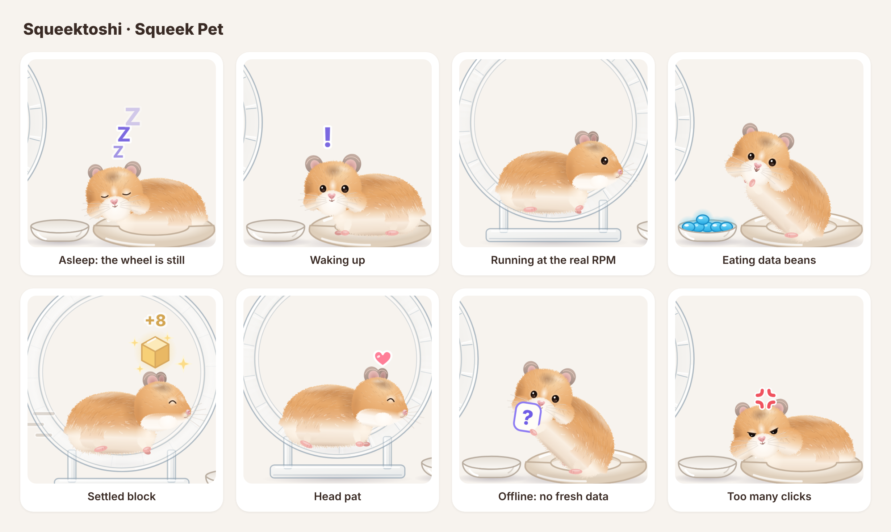

# Squeek Pet

[English](README.md)

一只住在你桌面上的仓鼠，和 SqueekChain（Sepolia 测试网）上 **Squeektoshi 的真实跑轮**同步。

真实跑轮转起来，它就醒来，按真实转速奔跑。新测到的工作量会变成蓝色数据豆堆在跑轮旁边，跑完它会把豆子吃掉，再打个嗝报出准确的总数。链上结算出新的 Squeek 区块时，会冒出一个金色方块。数据过期或拿不到时，它会抱着问号等着，不会假装在睡觉。

平时它只是屏幕角落里的一只小仓鼠。鼠标移上去能看状态气泡，双击打开迷你面板。



> 状态：**MVP，版本 0.1.0。** 没有现成的安装包，需要[从源码编译](#从源码安装)，几分钟就好。已经在 Linux 和 Apple 芯片的 Mac 上编译运行过，**Windows 还没编译过**。

## 安全和隐私

- 只读：只访问一个公开接口 `GET https://api.squeekchain.com/v1/status`。不连钱包，不碰私钥，不签名，不发交易。
- 没有账号、没有统计、不收集个人数据。设置只保存在你自己的电脑上。
- 只会打开 Squeek Pulse、SqueekChain 文档和 Sepolia 区块浏览器的链接。

## 从源码安装

在自己电脑上编译出来的 app 不会被 macOS 拦截，打开时不会提示"无法验证开发者"。

**1. 先装好工具（只需要装一次）**

- [Node.js](https://nodejs.org/) 20.19 或更新版本。
- [Rust](https://www.rust-lang.org/zh-CN/tools/install)（stable 版，用 rustup 安装）。
- macOS：Xcode 命令行工具，在终端运行 `xcode-select --install`。
- Linux：按 [Tauri 环境说明](https://v2.tauri.app/zh-cn/start/prerequisites/) 安装 WebKitGTK 等依赖。
- Windows：还没编译和测试过。可以按 Tauri 环境说明试试，但可能会遇到问题。

**2. 下载并编译**

```bash
git clone https://github.com/zakehowell/squeek-pet.git
cd squeek-pet
npm ci
npm run desktop:build
```

第一次编译要下载 Rust 依赖，需要几分钟。在 Apple 芯片的 Mac 上，正式版编译大约 80 秒。在 Mac 上只想要 app、不要 `.dmg` 的话，最后一步改成 `npm run desktop:build -- --bundles app`。

**3. 打开**

- macOS：`src-tauri/target/release/bundle/macos/Squeek Pet.app`，拖进"应用程序"文件夹即可。`src-tauri/target/release/bundle/dmg/` 里还有一个 `.dmg`。
- Linux：安装包在 `src-tauri/target/release/bundle/` 里（deb、rpm、appimage）。

仓鼠会出现在屏幕右下角。从托盘或菜单栏图标可以退出。

以后更新：先运行 `git pull`，再运行一次 `npm ci` 和 `npm run desktop:build`。

没有签名的安装包。如果把编译好的 app 直接拷给别人，对方第一次打开会被 macOS 拦下（macOS 15 及以后：系统设置 → 隐私与安全性 → 仍要打开；更早的版本：右键 → 打开），Windows 也可能弹出 SmartScreen 警告。让每个人在自己电脑上从源码编译，就没有这个问题。

## 怎么和它玩

| 你 | 仓鼠 |
| --- | --- |
| 鼠标移上去 | 看着你，显示状态气泡（睡觉时显示 `Zzz…`） |
| 鼠标在附近移动 | 眼睛跟着转 |
| 单击 | 眨眨眼；打开声音时会吱一声 |
| 快速连点四下 | 生一会儿气 |
| 在头上来回蹭 | 眯眼开心，冒出爱心 |
| 拖动 | 换个位置，会记住 |
| 双击 | 迷你面板：跑轮状态、转速、今天的距离、测到的工作量、结算区块和交易链接 |
| 右键 | 菜单：详情、大小、声音、演示模式、Squeek Pulse、设置、隐藏、退出 |

设置里可以改：语言（中文 / English，默认跟随系统）、大小（40% 到 150%，默认 75%）、动画流畅度（省电 15 帧、均衡 30 帧、流畅 60 帧，也决定读取频率）、每颗豆子代表的工作量、置顶、开机启动、声音（默认关闭）、活动通知和演示模式。演示模式始终标着 `DEMO`，不会和真实数据混在一起。

## 浏览器版 Squeek Pet Web

浏览器版延续 [zakehowell/squeek-pet](https://github.com/zakehowell/squeek-pet) 的 MIT 源码和原创美术；现有站点是 [squeek-pet.imd.site](https://squeek-pet.imd.site)。这是社区作品，不代表 SqueekChain 官方认可。

- 点击摸摸 / 喂豆 / 叫醒，或按 `P` / `F` / `W`，播放爱心、吃零食和伸懒腰动画。跑步或刚醒来时不能喂豆。已醒来时叫醒可能请求重新读取 API。这些操作只影响本地表现，不修改真实跑轮状态、工作量、余额或 API 快照。
- 双击仓鼠或跑轮打开详情，再打开设置。设置地址相对于当前目录解析，支持 `/ipfs/<cid>/`。保持仓鼠页面打开，在设置中切换语言，标题、提示、按钮文字、悬浮标题和无障碍名称无需刷新就会更新。浏览器页面在系统深色模式下仍使用清晰的浅色界面文字配色；桌面浮层继续跟随系统。
- `?demo=1` 显式启用 60 秒本地演示，`?demo=0` 读取真实 API；`?lang=en` / `?lang=zh` 选择初始语言。演示的 46–53 秒是模拟离线，两种语言均持续显示 `DEMO`。API 出错不会自动切换演示。
- 浏览器设置按来源保存在本地；托盘、开机启动、窗口拖动和置顶等功能需要 Tauri。声音默认关闭，开启后仍需用户操作解锁。

真实数据来源为只读 `GET https://api.squeekchain.com/v1/status`，根据性能设置每 2–10 秒读取。没有钱包、代币、交易、新后端或秘密。CORS、API 可用性和数据时效会影响同步。失败后保留内存中的上次快照，过期则显示离线；没有读数时先加载再显示离线，不伪造真实读数。刷新页面或切换数据源后不保留快照。

本次浏览器修复发布的实时同步**尚未验证**：2026-11-01 直接 GET API 返回 HTTP 403 / Cloudflare 验证。历史版本成功读取 API 不代表本次仍可同步。

运行 `npm ci`、`npm test`、`npm run typecheck` 和 `npm run build -- --base=./`。静态发布应包含整个 `dist/`（包括设置页和资源）；相对路径参数用于 IPFS 子目录，默认桌面构建不变。运行 `npm run dev` 后，在浅色和深色模式打开 `/tests/browser.html`，检查语言、无障碍名称、焦点、按钮回调和文字对比度的 PASS/FAIL。`npm test` 还覆盖子目录导航、Tauri 设置命令、演示离线标签和不修改遥测的互动动画。桌面打包和各系统窗口行为未在本次浏览器检查中重新验证。更多用法和限制见 [English README](README.md#squeek-pet-web)。

## 许可

代码和美术（仓鼠、跑轮、碗、窝和图标）都是原创，按 [MIT](LICENSE) 开源。不包含 SqueekChain 官方美术。SqueekChain 的名称、商标、文档和 API 仍归其所有者，不在本项目的许可范围内。
